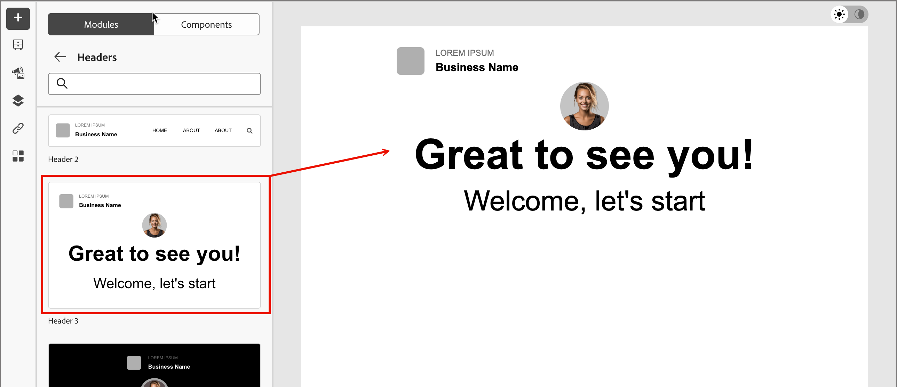

# Création de contenu - modules

Utilisez les [modules de contenu](../user/content/content-modules.md) pour créer votre conception à partir de sections préparées, telles que les en-têtes, les bannières, les cartes et les pieds de page. Chaque module comprend la structure, le style et le contenu par défaut que vous pouvez personnaliser.

1. Dans l’espace de conception visuelle, sélectionnez l’onglet **[!UICONTROL Modules]** s’il n’est pas visible.

   {width="500" zoomable="yes"}

1. Parcourez les catégories ou utilisez le champ de recherche pour trouver un module par nom.

   Développez une catégorie pour passer en revue ses variantes de disposition.

1. Faites glisser une variante de module sur la zone de travail.

   {width="650" zoomable="yes"}

1. Sélectionnez les éléments dans le module pour remplacer le texte, les images et les liens par défaut par votre propre contenu.

1. Utilisez les onglets **[!UICONTROL Paramètres]** et **[!UICONTROL Styles]** pour personnaliser le composant sélectionné.

   {width="650" zoomable="yes"}

   Pour ajouter plus de contenu au module, sélectionnez l’onglet **[!UICONTROL Composants]** et faites glisser un composant de contenu dans le module.