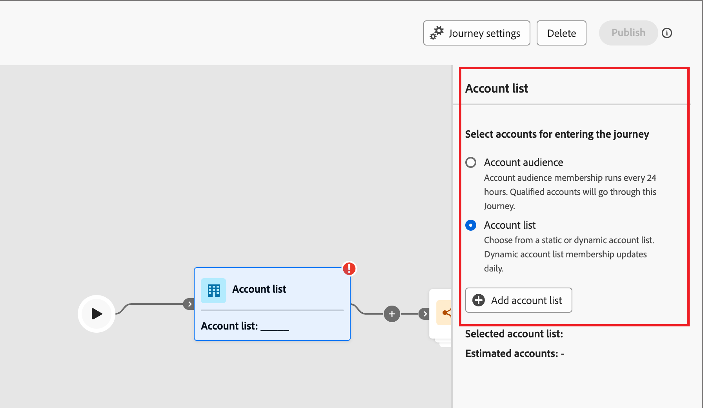

# Utilisation des listes de comptes dans parcours

Vous pouvez incorporer des listes de comptes dynamiques (publiés) de différentes manières dans les parcours de votre compte.

## Nœud d’audience de compte

Tous les parcours de compte commencent par un nœud [_Audience du compte_](../journeys/account-audience-nodes.md). Lorsque vous définissez ce nœud pour utiliser une liste de comptes, les comptes de membres se déplacent dans le parcours lors de sa mise en ligne (publication).

1. Sélectionnez l’option **[!UICONTROL Liste des comptes]** pour le nœud de départ _Audience du compte_.

   {width="500"}

1. Cliquez sur **[!UICONTROL Ajouter une liste de comptes]**.

1. Cochez la case de la liste des comptes et cliquez sur **[!UICONTROL Enregistrer]**.

   {width="600" zoomable="yes"}

## Nœud Prendre une action - Ajouter à la liste

**_Listes de comptes statiques uniquement_**

Dans un parcours de compte, ajoutez des comptes à une liste de comptes statique à l’aide du nœud [a _Prendre une action_](../journeys/action-nodes.md).

Par exemple, vous disposez d’un chemin de parcours où vous envoyez un e-mail et certains comptes prennent différentes actions en réponse. Vous considérez cette activité comme un point de qualification dans le parcours. Avec la qualification, vous souhaitez les ajouter à une liste de comptes utilisée comme audience pour un autre parcours avec un flux différent pour les comptes qualifiés.

>[!NOTE]
>
>Si un compte figure déjà dans la liste lors de l’exécution du nœud, l’action est ignorée.

1. Sélectionnez l’option _[!UICONTROL Action sur]_ **[!UICONTROL Comptes]**.

1. Pour _[!UICONTROL Action sur les comptes]_, choisissez **[!UICONTROL Ajouter à la liste des comptes]**.

   {width="500"}

1. Pour **[!UICONTROL Sélectionner la liste des comptes statiques actifs]**, choisissez la liste des comptes dans laquelle vous souhaitez ajouter des comptes.

   {width="500"}

## Nœud Prendre une action - Supprimer du compte

**_Listes de comptes statiques uniquement_**

Dans un parcours de compte, supprimez des comptes d’une liste de comptes statique à l’aide du nœud [a _Prendre une action_](../journeys/action-nodes.md).

Par exemple, vous disposez d’un chemin de parcours où vous envoyez un e-mail et certains comptes prennent différentes actions en réponse. Vous considérez cette activité comme un point de qualification dans le parcours. Avec cette qualification, vous souhaitez les supprimer d’une liste de comptes. Cette liste est utilisée comme audience pour un autre parcours qui envoie des e-mails supplémentaires afin que vous ne dupliquiez pas vos communications de qualification.

>[!NOTE]
>
>Si un compte ne figure pas dans la liste où sa suppression est planifiée, l’action est ignorée.

1. Sélectionnez l’option _[!UICONTROL Action sur]_ **[!UICONTROL Comptes]**.

1. Pour _[!UICONTROL Action sur les comptes]_, choisissez **[!UICONTROL Supprimer de la liste des comptes]**.

   {width="500"}

1. Pour **[!UICONTROL Sélectionner la liste des comptes statiques actifs]**, choisissez la liste des comptes dans laquelle vous souhaitez supprimer des comptes.

   {width="500"}

## Nœud de chemins de division - Membre du compte de la liste des comptes {#split-paths-account-member-of-account-list}

**_parcours de compte uniquement_**

Utilisez le filtre _[!UICONTROL Membre du compte de la liste des comptes]_ dans un nœud [_Partage des chemins_](../journeys/split-merge-paths-nodes.md#add-a-split-path-by-account-node) qui fractionne par comptes. Le compte est membre ou non d’une ou de plusieurs listes de comptes sélectionnées. Pour inclure des comptes dans les listes, définissez l’abonnement sur `true` ou définissez-le sur `false` pour les exclure.

Pour exclure des comptes sur une, ajoutez le filtre _[!UICONTROL Membre du compte de la liste des comptes]_, définissez l’appartenance sur `false` et sélectionnez la liste.

1. Accédez à la carte du parcours.

1. Cliquez sur l’icône plus ( **+** ) d’un chemin d’accès et choisissez **[!UICONTROL Fractionner les chemins d’accès]**.

1. Dans les propriétés de nœud sur la droite, choisissez **[!UICONTROL Comptes]** pour la division.

1. Pour définir une condition pour _[!UICONTROL Chemin 1]_, cliquez sur **[!UICONTROL Appliquer la condition]**.

1. Définissez le filtre de la liste des comptes.

   * Dans l’éditeur de conditions, développez le dossier _[!UICONTROL Filtres spéciaux]_ et faites glisser le filtre **[!UICONTROL Membre du compte de la liste des comptes]** sur l’espace de travail des conditions.

   * Pour inclure des comptes dans les listes, définissez l’abonnement sur `true` ou définissez-le sur `false` pour les exclure.

   * Sélectionnez une ou plusieurs listes de comptes.

   {width="700" zoomable="yes"}

   Vous pouvez combiner le filtre d’appartenance à la liste des comptes avec d’autres filtres de compte et choisir de correspondre à toutes les conditions ou à n’importe quelle condition. Affinez vos conditions en appliquant la **[!UICONTROL logique de filtre]** en haut.

1. Cliquez sur **[!UICONTROL Terminé]**.

Continuez à configurer le nœud de chemin de partage comme décrit dans [Ajouter un chemin de partage par nœud de compte](../journeys/split-merge-paths-nodes.md#add-a-split-path-by-account-node).

## Nœud de chemins partagés - Membre de la personne de la liste des comptes {#split-paths-member-of-account-list}

**_parcours de personne uniquement_**

Utilisez les filtres d’appartenance à la liste des comptes dans un nœud [_Partage des chemins_](../journeys/split-merge-paths-nodes.md) d’un parcours de personne pour acheminer les personnes en fonction du fait que leur compte est membre ou non d’une liste de comptes. Deux filtres sont disponibles :

| Filtre | Description |
| ------ | ----------- |
| [!UICONTROL Membre de la liste dynamique de compte d’une personne] | Le compte de la personne est membre ou non d’une ou de plusieurs listes de comptes dynamiques. |
| [!UICONTROL Membre de la personne de la liste statique du compte] | Le compte de la personne est membre ou non d’une ou de plusieurs listes de comptes statiques. |

Pour exclure des personnes dans des comptes placés sur la liste bloquée d’un chemin d’accès de maturation, ajoutez le filtre _[!UICONTROL Liste statique des membres de compte de personne]_, définissez l’opérateur sur `is not` et sélectionnez la liste.

1. Accédez à la carte du parcours.

1. Cliquez sur l’icône plus ( **+** ) d’un chemin d’accès et choisissez **[!UICONTROL Fractionner les chemins d’accès]**.

1. Pour définir une condition pour _[!UICONTROL Chemin 1]_, cliquez sur **[!UICONTROL Appliquer la condition]**.

1. Définir le filtre de la liste des comptes

   * Dans l’éditeur de conditions, développez le dossier _[!UICONTROL Filtres spéciaux]_ et faites glisser le filtre **[!UICONTROL Membre de la liste dynamique de compte]** ou **[!UICONTROL Membre de la liste statique de compte]** sur l’espace de travail des conditions.

   * Pour inclure les personnes dont le compte figure dans la liste, définissez l’opérateur sur `is` ou définissez-le sur `is not` pour les exclure.

   * Sélectionnez une ou plusieurs listes de comptes.

     {width="700" zoomable="yes"}

   Vous pouvez combiner les filtres d’appartenance à une liste de comptes avec d’autres filtres de personnes et choisir de correspondre à toutes les conditions ou à n’importe quelle condition. Affinez vos conditions en appliquant la **[!UICONTROL logique de filtre]** en haut.

1. Cliquez sur **[!UICONTROL Terminé]**.

Continuez à configurer le nœud de chemin de partage comme décrit dans [Ajouter un chemin de partage par le nœud de personnes](../journeys/split-merge-paths-nodes.md#add-a-split-path-by-people-node).
