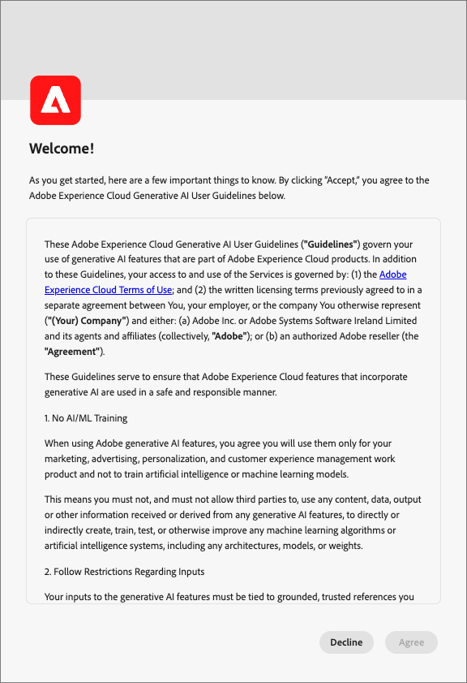
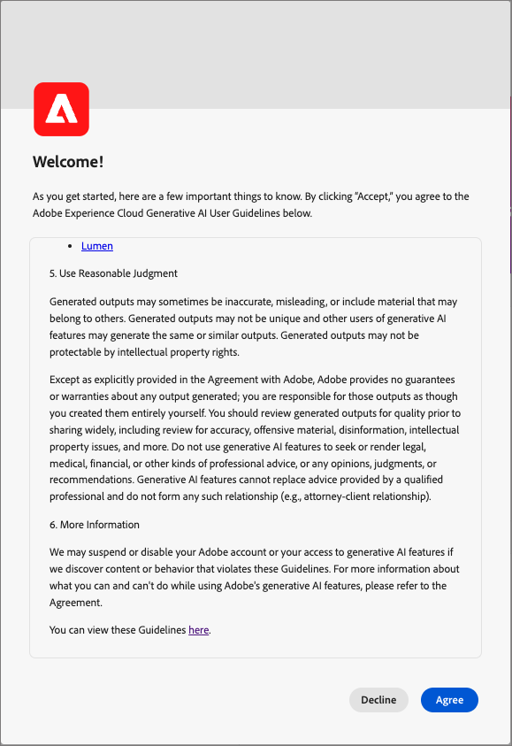

# Fonctionnalités d’IA dans Journey Optimizer B2B Edition

Utilisez les fonctionnalités d’IA de [!DNL Adobe Journey Optimizer B2B Edition] pour générer du contenu, explorer les connaissances du produit et obtenir des informations opérationnelles.

>[!IMPORTANT]
>
>Un accord sur les [instructions d’utilisation](https://www.adobe.com/fr/legal/licenses-terms/adobe-gen-ai-user-guidelines.html){target="_blank"} est requis avant de pouvoir utiliser les fonctionnalités d’IA dans [!DNL Journey Optimizer B2B Edition]. Cet accord contient également l’accord public Beta afin que vous puissiez utiliser des fonctionnalités supplémentaires compatibles avec l’IA lors de leur déploiement.

+++Affichage de l’interface du contrat utilisateur

+++

## Utilisation de l’application [!DNL Coworker] {#coworker-app}

Utilisez l’interface de l’application [!DNL CX Enterprise Coworker] pour tous les workflows de conversation autres que la génération de contenu. Posez des questions sur les produits, explorez les informations opérationnelles et utilisez les [compétences de parcours &#x200B;](../agents/journey-agent.md) et [compétences d’audience pour les comptes et les personnes B2B](../agents/audience-agent-b2b.md). La génération de contenu reste disponible dans [!DNL Journey Optimizer B2B Edition].

Pour obtenir des instructions sur l&#39;ouverture de l&#39;application, le démarrage de conversations et l&#39;utilisation des fonctionnalités de chat, consultez le guide de l&#39;interface de CX Coworker [&#128279;](https://experienceleague.adobe.com/en/docs/coworker/content/chat/ui-guide){target="_blank"}.

Pensez au type de demande dont vous avez besoin avant d&#39;envoyer une requête de conversation [!DNL Coworker].

### Connaissances du produit

La connaissance des produits fait référence aux concepts et aux sujets abordés dans la documentation [!DNL Journey Optimizer B2B Edition] sur [!DNL Adobe Experience League]. Les questions relatives à la connaissance des produits peuvent être spécifiées de manière plus détaillée dans les sous-groupes suivants :

| Connaissances du produit | Exemples |
| --- | --- |
| Apprentissage par points | <li>Qu&#39;est-ce qu&#39;un groupe d&#39;achat ? <li> Me montrer un exemple de modèle de rôles de groupe d&#39;achat ? |
| Découverte ouverte | <li>Quelles sont les étapes pour créer des groupes d&#39;achat ? <li>Comment utiliser les champs personnalisés dans un modèle de rôles de groupe d&#39;achats ? |
| Dépannage | <li>Pourquoi les groupes d&#39;achat pour mon parcours n&#39;ont-ils pas été créés ? <li>Pourquoi ne puis-je pas trouver des événements d’expérience à écouter dans le parcours ? |

### Informations opérationnelles

_Informations opérationnelles_ se rapportent aux réponses que [!DNL Coworker] générez sur vos objets de métadonnées (attributs, audiences de compte, flux de données, jeux de données, destinations, parcours de compte, schémas, sources, modèles de groupe d’achat et centres d’intérêt des solutions). Ces informations incluent les nombres, les recherches et l’impact de la parenté. Elles n’examinent aucune donnée dans le sandbox.

* Quelle audience de compte a la plus grande taille d’audience et quelle est cette taille ?
* Combien d’audiences de compte n’ont jamais été utilisées dans aucun parcours ?
* Quels parcours actifs utilisent l’intérêt de la solution _x_ ?

Vous pouvez poser des questions [!DNL Coworker] sur vos informations opérationnelles dans les domaines suivants :

| Domaine | Métadonnées prises en charge | Métadonnées non prises en charge |
| --- | --- | --- |
| Attributs/champs | <li>Recherche de nom d’attribut <li>Attribut - relation de schéma <li>Attribut - relation du jeu de données <li>Attribut - Relation d’audience <li>Attribut - relation de destination | <li>Classe d’attribut <li>Journal <li>Statut d’obsolescence <li>Libellés <li>Valeur stockée dans les attributs |
| Audiences du compte   **_Remarque:_** dans le contexte [!DNL Journey Optimizer B2B Edition], [!DNL Coworker] conversation ne peut répondre qu’aux questions sur l’audience pour les audiences du compte. Dans le contexte [!DNL Adobe Experience Platform], [!DNL Coworker] conversation ne peut répondre qu’à des questions pour les audiences de personnes. | <li>Nombre d’audiences <li>Type d’audience (diffusion en continu ou par lots) <li>Dates de création/modification <li>Statut d’activation <li>Nombre de membres <li>Dupliquer les audiences <li>Recherche par nom et ID | <li>Chevauchements des audiences <li>Activation d’audience <li>Journal <li>Créer/modifier <li>Libellés <li>Tendances de qualification des membres |
| Flux de données | <li>Nombre de flux de données <li>Statut du flux de données <li>Flux de données - Relation du jeu de données <li>Flux de données - Relation source | <li>Création/modification <li>Relations flux de données-lot <li>Ingérer le nombre de profils |
| Jeux de données | <li>Nombre de jeux de données <li>Statut d’activation du profil <li>Date de création/modification <li>Jeu de données - Relation de schéma <li>Jeu de données - Relation d’audience <li>Relation jeu de données - attribut <li>Jeu de données - Relation de flux de données <li>Recherche de nom <li>Recherche par nom et ID | <li>Journal <li>Création par <li>Jeu de données - Relation par lots <li>Création/modification de jeu de données <li>Taille du jeu de données <li>Nombre de profils <li>Nombre de lignes <li>Recherche de valeur |
| Destinations | <li>Nombre de destinations configurées <li>Relation destination-audience <li>Relation d’attributs de destination | <li>Configuration du compte <li>Informations d’identification du compte <li>Profils uniques activés |
| Parcours (Parcours de compte) | <li>Nombre <li>Recherche par nom et ID <li>Statut du parcours <li>Dates de création/modification | <li>Attributs - Relations de parcours <li>Journal <li>Création/modification <li>Création par |
| Schémas | <li>Nombre de schémas <li>Date de création/modification <li>Schéma - Relation des attributs <li>Schéma - Relation du jeu de données <li>Schéma - Relation d’audience <li>Statut d’activation du profil <li>Recherche de nom <li>Recherche par nom et ID | <li>Journal <li>Création/modification <li>Création par <li>Groupes de champs <li>Identités <li>Espaces de noms d’identité <li>Libellés <li>Nombre de profils |
| Sources | <li>Comptes <li>Statut du compte <li>Flux de données actifs/inactifs pour chaque compte <li>Connecteur Source - Relation de flux de données <li>Compte Source - relation du flux de données | <li>Informations d’identification du compte <li>Configuration du compte Mesures d’ingestion de données <li>Nombre de relations profilsSource - lot |
| Modèle de groupe d&#39;achat | <li>Comptages <li>Statut <li>Rôles <li>Recherche par nom et ID | <li>Règles de rôle |
| Intérêt de la solution | <li>Comptages <li>Statut <li>Intérêt de la solution - Relation du modèle de groupe d’achat <li>Recherche par nom et ID | <li>Intérêt de la solution - Relation du groupe d’achat |

{style="table-layout:fixed"}

Pour les questions relatives aux informations opérationnelles, les réponses peuvent ne pas refléter l’état actuel de l’interface utilisateur. Les données sur lesquelles reposent ces questions sont mises à jour toutes les 24 heures. Par exemple, les modifications apportées par les utilisateurs et utilisatrices dans [!DNL Adobe Real-Time Customer Data Platform] pendant la journée sont synchronisées avec les banques de données la nuit, puis répondent aux questions des utilisateurs et utilisatrices le matin. Pour plus d’informations sur des données spécifiques liées aux objets , connectez-vous à un sandbox.

### Confidentialité, sécurité et gouvernance

[!DNL Coworker] conversation dans [!DNL Journey Optimizer B2B Edition] donne la priorité à la confidentialité, à la sécurité et à la gouvernance. Consultez les informations suivantes pour en savoir plus sur les fonctionnalités axées sur la confiance du client que vous pouvez attendre de [!DNL Coworker] conversation :

* [!DNL Coworker] n&#39;utilise pas de données personnelles aujourd&#39;hui, même à des fins de formation.

* Vous pouvez consulter un journal de 30 jours de vos interactions précédentes avec [!DNL Coworker] chat.

* La [!DNL Coworker] est basée sur des données spécifiques au sandbox et sur la documentation publique d’Adobe lors de la réponse aux invites. Les données ne sont pas partagées entre les sandbox.

* Les invites que vous fournissez à [!DNL Coworker] chat ne sont pas partagées avec les autres clients.

## Étapes suivantes

Avec une compréhension générale de [!DNL Coworker] conversation, continuez à l’activer et à l’utiliser pendant vos workflows. Pour plus d’informations, reportez-vous à la documentation suivante :

* [Activer l’accès aux fonctionnalités d’IA](./enable-ai-access.md)
* [Conseils sur les questions](./question-guidance.md)
* [Guide de l’interface de CX Coworker](https://experienceleague.adobe.com/en/docs/coworker/content/chat/ui-guide){target="_blank"}
