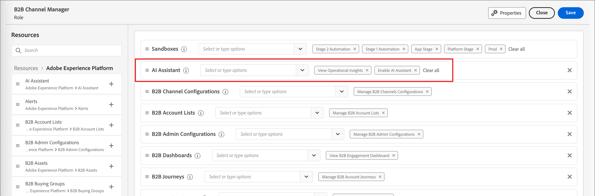

# Activer l’accès à l’IA

>[!IMPORTANT]
>
>Si vous recevez un message dans l’interface utilisateur des autorisations pour vous informer que votre entreprise doit d’abord accepter des conditions juridiques supplémentaires pour accéder à [!DNL Coworker] conversation, contactez votre équipe de compte Adobe pour obtenir des conseils.

Utilisez l’interface utilisateur [Autorisations](https://experienceleague.adobe.com/en/docs/experience-platform/access-control/abac/permissions-ui/permissions){target="_blank"} pour accorder ou révoquer l’accès à [!DNL Coworker] conversation au sein de votre organisation. Pour utiliser [!DNL Coworker] conversation, un utilisateur donné doit appartenir à un rôle configuré avec les autorisations _[!UICONTROL Activer l’assistant d’IA]_ et _[!UICONTROL Afficher les informations opérationnelles]_.

En tant qu’administrateur, vous pouvez :

* Ajoutez l’autorisation **[!UICONTROL Activer l’assistant IA]** à un rôle donné et ajoutez un utilisateur à ce rôle. Cette autorisation permet aux utilisateurs de votre organisation d’accéder à [!DNL Coworker] conversation.

* Ajoutez l’autorisation **[!UICONTROL Afficher les informations opérationnelles]** à un rôle donné et ajoutez un utilisateur à ce rôle. Cette autorisation permet à l’utilisateur d’utiliser les fonctionnalités d’informations opérationnelles du chat [!DNL Coworker].

{width="800" zoomable="yes"}

Utilisez l’interface utilisateur Autorisations pour octroyer des autorisations d’utilisation de la conversation [!DNL Coworker] dans [!DNL Adobe Journey Optimizer B2B Edition]. Pour plus d’informations sur l’accès à [!DNL CX Coworker] dans [!DNL Adobe Experience Platform] et d’autres applications [!DNL Adobe Experience Cloud], consultez la documentation de [CX Enterprise Coworker](https://experienceleague.adobe.com/en/docs/coworker/content/chat/overview){target="_blank"}.

Lorsque l&#39;utilisateur dispose des autorisations nécessaires, il peut accéder [!DNL Coworker] chat en sélectionnant l&#39;icône _[!DNL Coworker]chat_ dans l&#39;en-tête supérieur de l&#39;application.

![[!DNL Coworker] icône de conversation dans l’en-tête de l’application](./assets/coworker-icon-header.png){width="800" zoomable="yes"}
