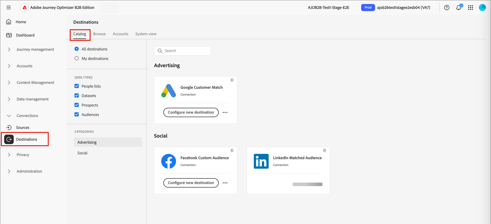

# Destinations

Les destinations sont des intégrations préconfigurées qui vous permettent d’envoyer des [membres de listes statiques de personnes](./people-lists-static.md) et des audiences de parcours de compte aux plateformes sociales. L’activation d’une liste statique vers une destination synchronise l’abonnement. Lorsque des personnes sont ajoutées à la liste ou supprimées de celle-ci, elles sont automatiquement ajoutées ou supprimées de l’audience de destination et, par extension, de toute campagne alimentée par l’audience.

Il existe trois façons d’activer des personnes vers une destination connectée :

* **À partir d&#39;une liste statique** - Activez une liste statique existante directement à partir de l&#39;onglet **_[!UICONTROL Listes de personnes]_**. Voir [_Activer vers une destination_](./people-lists-static.md#static-list-activate).
* **À partir d’un parcours de compte** - Ajoutez un nœud d’action **_[!UICONTROL Activer vers la destination]_** à un chemin de parcours afin que les comptes admissibles soient activés vers la destination lorsqu’ils atteignent ce nœud. Voir [_Activer vers une destination ou la désactiver_](../journeys/action-nodes.md#activate-deactivate-destination).
* **À partir d&#39;un groupe d&#39;achats** - Pour remplir des rôles vides dans vos groupes d&#39;achats, vous pouvez activer une Audience appariée LinkedIn pour cibler les prospects qui correspondent aux paramètres de votre groupe d&#39;achats. Voir [_LinkedIn Account Matched audience_s](../data/linkedin-account-matched-audiences.md#activate-buying-group).

>[!BEGINSHADEBOX]

## Autorisations nécessaires {#required-permissions}

La fonctionnalité de destination complète nécessite les autorisations [!DNL Adobe Experience Platform] suivantes.

| Catégorie | Autorisation |
|--- |--- |--- |
| Sandbox | Accès aux sandbox |
| Tableaux de bord | Afficher les tableaux de bord standard |
| Tableaux de bord | Gestion des tableaux de bord standard |
| Destinations | Affichage des destinations |
| Destinations | Gestion des destinations |
| Destinations | Activation des destinations |
| Destinations | Activer un segment sans mappage |
| Destinations | Gérer et activer la destination du jeu de données |
| Destinations | Création de destinations |
| Gouvernance des données | Affichage des politiques d’utilisation des données |
| Gouvernance des données | Gestion des politiques d’utilisation des données |
| Ingestion de données | Affichage des sources |
| Ingestion de données | Gestion des sources |
| Gestion des profils | Afficher les paramètres de profil |
| Gestion des profils | Gérer les paramètres de profil |

>[!ENDSHADEBOX]

## Destinations prises en charge {#supported-destinations}

Avant de pouvoir activer une liste statique, une destination doit exister dans le catalogue des destinations. Dans le volet de navigation de gauche, développez **[!UICONTROL Connexions]** et sélectionnez **[!UICONTROL Destinations]**. [!DNL Journey Optimizer B2B Edition] prend actuellement en charge la destination **[!UICONTROL LinkedIn Matched Audience]** (Social). Voir [_Audiences appariées du compte LinkedIn_](../data/linkedin-account-matched-audiences.md) à

<!-- 
the following destinations:

* **[!UICONTROL Google Customer Match]** (Advertising)
* **[!UICONTROL Facebook Custom Audience]** (Social)
* **[!UICONTROL LinkedIn Matched Audience]** (Social)

{width="800" zoomable="yes"}

-->

>[!NOTE]
>
>Le catalogue affiché n’est pas le catalogue de destinations [!DNL Adobe Experience Platform] complet. Si vous accédez directement aux destinations à partir de [!DNL Experience Platform], vous verrez un catalogue plus grand, mais seules ces destinations sont actuellement disponibles pour activation dans [!DNL Journey Optimizer B2B Edition]. D’autres destinations sont prévues pour les prochaines versions.

## Configurer une destination {#set-up-destination}

Chaque carte de destination prise en charge affiche **[!UICONTROL Configurer une nouvelle destination]**. La configuration d’une destination est une condition préalable à l’activation.

1. Dans la carte de connecteur, cliquez sur **[!UICONTROL Configurer une nouvelle destination]**.

   {width="500"}

1. Sélectionnez **[!UICONTROL Compte existant]** ou **[!UICONTROL Nouveau compte]** et saisissez les détails du compte, tels que son nom et sa description.

1. Cliquez sur **[!UICONTROL Se connecter à la destination]**.

   Un flux OAuth vous permet de vous connecter au compte correspondant : LinkedIn, Google ou Facebook.

   >[!IMPORTANT]
   >
   >À ce stade, ne saisissez pas les _[!UICONTROL détails de la destination]_. Seule la connexion est nécessaire.

1. Renseignez tout mappage de champs requis entre les attributs de personne et les champs requis par la destination.

1. Vérifiez les paramètres de gouvernance des données et d’action marketing, puis cliquez sur **[!UICONTROL Enregistrer]**.

Pour les étapes de configuration complètes, consultez [Créer une connexion de destination](https://experienceleague.adobe.com/fr/docs/experience-platform/destinations/ui/connect-destination){target="_blank"} dans la documentation [!DNL Experience Platform].

Une fois configurée, la destination peut être activée partout où vous pouvez sélectionner une destination dans [!DNL Journey Optimizer B2B Edition].

## Activation et synchronisation {#activation-sync}

L’activation est pilotée par l’appartenance à une liste statique, avec une synchronisation bidirectionnelle entre la liste et l’audience de destination :

* L’ajout d’une personne à la liste statique l’active dans la destination sous 24 heures, l’ajoutant ainsi à l’audience de destination et, par la suite, à toute campagne que l’audience alimente.
* Supprimer une personne de la liste statique la désactive de la destination. Elles sont supprimées de l’audience de destination et de toute campagne connectée.
* La même liste peut être activée vers plusieurs destinations à la fois. L’abonnement se synchronise sur tous les .

>[!TIP]
>
>Pour exécuter une campagne LinkedIn sur un segment, activez la liste statique de ces personnes vers votre destination LinkedIn Matched Audience. Toutes les personnes de la liste sont ajoutées à l’audience correspondante dans LinkedIn, où une campagne peut les cibler. L’audience reste automatiquement à jour au fur et à mesure que la liste change.
