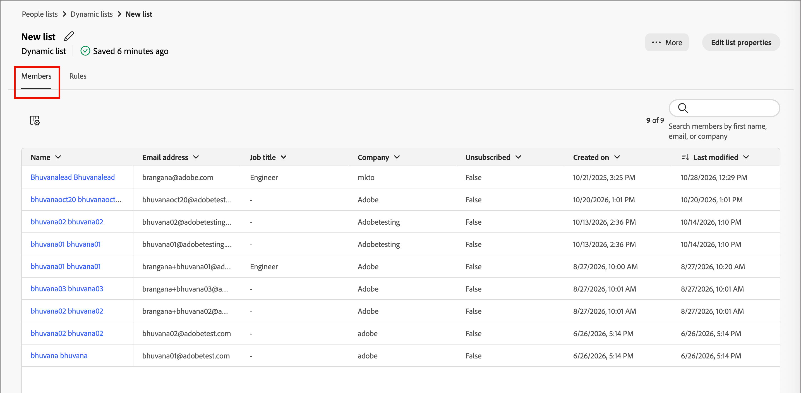

# Listes de personnes dynamiques

Une liste dynamique de [personnes](./people-lists.md) est une collection de profils de personnes définis par des règles (filtres). L’appartenance à une liste dynamique est définie à l’aide de filtres simples qui référencent des attributs et des activités de personne. L’appartenance est automatiquement conservée car les profils sont qualifiés et disqualifiés selon la logique du filtre.

Vous ne pouvez pas ajouter ou supprimer des personnes d’une liste dynamique. Pour modifier l’appartenance à la liste, mettez à jour ses règles. Si vous devez gérer l&#39;appartenance manuellement ou par le biais d&#39;un parcours, utilisez plutôt une [liste statique](./people-lists-static.md).

## Définir des règles d’appartenance {#set-membership-rules}

>[!NOTE]
>
>Une liste dynamique sans règles ne comporte aucun membre. Pour renseigner la liste, ajoutez au moins un filtre.

1. Ouvrez la liste dynamique et sélectionnez l’onglet **[!UICONTROL Règles]**.

1. Cliquez sur **[!UICONTROL Modifier les règles]**.

   {width="700" zoomable="yes"}

1. Dans la boîte de dialogue _[!UICONTROL Modifier les règles]_, définissez les règles de qualification des profils en faisant glisser des filtres depuis le panneau de gauche.

   Qualifiez les profils pour la liste à l’aide de n’importe quelle combinaison des éléments suivants :

   * Historique des activités
   * [!DNL Experience Platform] champs de personne activés
   * Champs personnalisés
   * Données d’intention
   * Attributs de la personne
   * Filtres spéciaux, tels que l’appartenance à un parcours

   Pour chaque filtre que vous ajoutez, cliquez sur **[!UICONTROL Ajouter des contraintes]** pour affiner les critères correspondants. Ajustez vos conditions en appliquant la **[!UICONTROL logique de filtre]** en haut. Vous pouvez choisir de correspondre à toutes les conditions, à n’importe quelle condition ou de définir une logique avancée.

   {width="700" zoomable="yes"}

1. Cliquez sur **[!UICONTROL Terminé]** pour enregistrer vos modifications.

   L’onglet **[!UICONTROL Règles]** affiche les filtres et la logique de filtrage de la liste, tandis que l’onglet **[!UICONTROL Membres]** s’actualise pour refléter l’appartenance mise à jour. Pour trouver les qualifications d’audience les plus récentes, utilisez **[!UICONTROL Actualiser les membres]** dans le menu **[!UICONTROL Plus]**.

1. Sélectionnez l’onglet **[!UICONTROL Membres]**.

   Les membres qualifiés apparaissent dans la liste après un bref délai.

   {width="700" zoomable="yes"}

>[!NOTE]
>
>Pour modifier les règles de liste à tout moment, vous pouvez répéter ces étapes. L’appartenance à la liste est actualisée en fonction des filtres enregistrés.

<!--

## Duplicate a dynamic list {#duplicate-dynamic-list}

Duplicating a dynamic list replicates its membership filtering so that you can reuse it in a different context.

1. In the _[!UICONTROL Dynamic lists]_ tab, click the _More menu_ ( **...** ) icon next to the list and choose **[!UICONTROL Duplicate]**.

1. Enter a unique **[!UICONTROL Name]** (required) and a **[!UICONTROL Description]** (optional).

   By default, the dialog appends `_copy` to the name of the originating list. Enter a different unique name as needed.

   {width="375"}

1. Click **[!UICONTROL Duplicate]**.
-->
