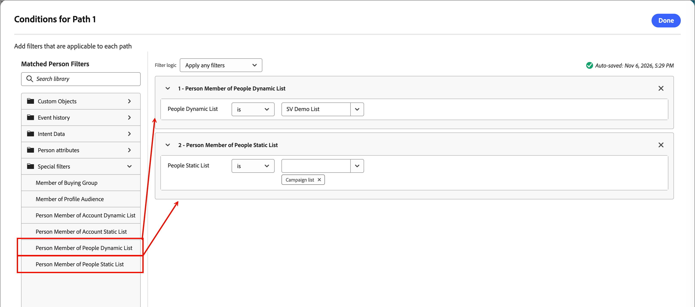

# Utilisation des listes de personnes dans les parcours

Vous pouvez incorporer des [listes de personnes](./people-lists.md) de différentes manières dans vos parcours de compte et vos parcours de personne :

* **Tenir à jour une liste statique à partir d&#39;un parcours** - Dans un nœud _Prendre une action_, utilisez l&#39;action _[!UICONTROL Ajouter à la liste des personnes]_ ou _[!UICONTROL Supprimer de la liste des personnes]_ pour mettre à jour l&#39;appartenance à une liste des personnes statique à mesure que les personnes se déplacent dans le parcours.
* **Routage des personnes en fonction de l’appartenance à une liste** - Dans un nœud _Partage de chemins_, utilisez le filtre _[!UICONTROL Membre de la liste statique des personnes]_ ou _[!UICONTROL Membre de la liste dynamique des personnes]_ pour créer un chemin d’accès pour les personnes qui sont (ou ne sont pas) membres d’une liste.

Par exemple, vous pouvez créer une liste d’exclusion des membres de l’équipe et des partenaires et l’utiliser pour exclure ces personnes d’un parcours d’apprentissage. Vous pouvez également ajouter des personnes à une liste statique lorsqu’elles atteignent un point de qualification dans un parcours, puis utiliser cette liste pour créer des branches dans un autre parcours.

## Nœud Prendre une action - Ajouter à la liste des personnes {#add-to-people-list}

**_Listes de personnes statiques uniquement_**

Dans un parcours de compte ou de personne, ajoutez des personnes à une liste de personnes statique à l’aide du nœud [a _Prendre une action_](../journeys/action-nodes.md#people-actions).

Prenons l’exemple d’un chemin de parcours où vous envoyez un e-mail et où certaines personnes s’inscrivent à un webinaire. Vous considérez cette réponse comme un point de qualification dans le parcours. Lors de la qualification, vous souhaitez ajouter ces personnes à une liste de personnes statique qu’un autre parcours utilise pour diviser des personnes qualifiées sur un autre chemin.

>[!NOTE]
>
>Si une personne figure déjà dans la liste lors de l’exécution du nœud, l’action est ignorée.

1. Accédez à la carte du parcours.

1. Cliquez sur l’icône plus ( **+** ) d’un chemin d’accès et choisissez **[!UICONTROL Exécuter une action]**.

1. (parcours de compte uniquement) Sélectionnez l’option _[!UICONTROL Action sur]_ **[!UICONTROL Personnes]**.

1. Pour _[!UICONTROL Action sur les personnes]_, choisissez **[!UICONTROL Ajouter à la liste des personnes]**.

1. Pour **[!UICONTROL Sélectionner une liste de personnes statique]**, choisissez la liste de personnes dans laquelle vous souhaitez ajouter des personnes.

   {width="300"}

## Nœud Prendre une action - Supprimer de la liste des personnes {#remove-from-people-list}

**_Listes de personnes statiques uniquement_**

Dans un parcours de compte ou de personne, supprimez des personnes d’une liste de personnes statique à l’aide du nœud [a _Agir_](../journeys/action-nodes.md#people-actions).

Par exemple, après une conversion, vous pouvez supprimer une personne d’une liste statique. Cette liste est utilisée pour acheminer les personnes vers un chemin d’apprentissage afin qu’elles ne reçoivent plus de communications d’apprentissage.

>[!NOTE]
>
>Si une personne ne figure pas dans la liste dont la suppression est prévue, l’action est ignorée.

1. Accédez à la carte du parcours.

1. Cliquez sur l’icône plus ( **+** ) d’un chemin d’accès et choisissez **[!UICONTROL Exécuter une action]**.

1. (parcours de compte uniquement) Sélectionnez l’option _[!UICONTROL Action sur]_ **[!UICONTROL Personnes]**.

1. Pour _[!UICONTROL Action sur les personnes]_, choisissez **[!UICONTROL Supprimer de la liste des personnes]**.

1. Pour **[!UICONTROL Sélectionner une liste de personnes statique]**, choisissez la liste de personnes dans laquelle vous souhaitez supprimer des personnes.

   {width="300"}

## Nœud de chemins partagés - Membre de la liste des personnes {#split-paths-by-list-membership}

**_parcours de compte et de personne_**

Utilisez les filtres d’appartenance à la liste des personnes dans un [_nœud de_ fractionné](../journeys/split-merge-paths-nodes.md) pour acheminer les personnes selon qu’elles sont membres d’une liste de personnes. Deux filtres sont disponibles :

| Filtre | Description |
| ------ | ----------- |
| [!UICONTROL Membre de la liste dynamique des personnes] | La personne est membre ou non d’une ou de plusieurs listes de personnes dynamiques. L’appartenance reflète les règles actuelles de la liste. |
| [!UICONTROL Membre de la liste statique des personnes] | La personne est membre ou non d’une ou de plusieurs listes de personnes statiques. |

Ces filtres sont disponibles dans les deux types de parcours :

* **parcours de personne** - dans un nœud _Partage de chemins_.
* **parcours de compte** - Dans un nœud _Partage de chemins_ qui est divisé par _[!UICONTROL Personnes]_.

Pour exclure des membres de l’équipe et des partenaires d’un chemin d’apprentissage, ajoutez le filtre _[!UICONTROL Membre de la liste statique des personnes]_, définissez l’opérateur sur `is not` et sélectionnez la liste.

1. Accédez à la carte du parcours.

1. Cliquez sur l’icône plus ( **+** ) d’un chemin d’accès et choisissez **[!UICONTROL Fractionner les chemins d’accès]**.

   {width="300" zoomable="no"}

1. (parcours de compte uniquement) Définissez le nœud pour les conditions des personnes.

   * Dans les propriétés de nœud sur la droite, choisissez **[!UICONTROL Personnes]** pour la division.

   * Définissez **[!UICONTROL Attributs utilisés pour les conditions]** sur **[!UICONTROL Attributs de personne uniquement]**.

   {width="300" zoomable="no"}

1. Pour définir une condition pour _[!UICONTROL Chemin 1]_, cliquez sur **[!UICONTROL Appliquer la condition]**.

1. Dans l’éditeur de conditions, développez le dossier _[!UICONTROL Filtres spéciaux]_ et faites glisser le filtre **[!UICONTROL Membre de la liste dynamique des personnes]** ou **[!UICONTROL Membre de la liste statique des personnes]** sur l’espace de travail des conditions.

   {width="700" zoomable="yes"}

1. Pour inclure des membres de liste, définissez l’appartenance sur `is`.

   Pour les exclure, définissez-le sur `is not`.

1. Sélectionnez la liste de personnes à évaluer.

   Saisissez du texte dans le champ pour filtrer les listes disponibles. Seules les listes de personnes créées par l’utilisateur peuvent être sélectionnées.

1. Affinez vos conditions en appliquant la **[!UICONTROL logique de filtre]** en haut.

   Vous pouvez combiner les filtres d’appartenance à une liste avec d’autres filtres de personnes et choisir de correspondre à toutes les conditions ou à n’importe quelle condition.

1. Cliquez sur **[!UICONTROL Terminé]**.

Continuez à configurer le nœud de chemins de partage comme décrit dans [_Ajouter un chemin de partage par le nœud de personnes_](../journeys/split-merge-paths-nodes.md#add-a-split-path-by-people-node). Pour plus d&#39;informations sur les filtres d&#39;appartenance, voir [_Filtrage des appartenances_](../journeys/split-merge-paths-nodes.md#membership-filtering).
