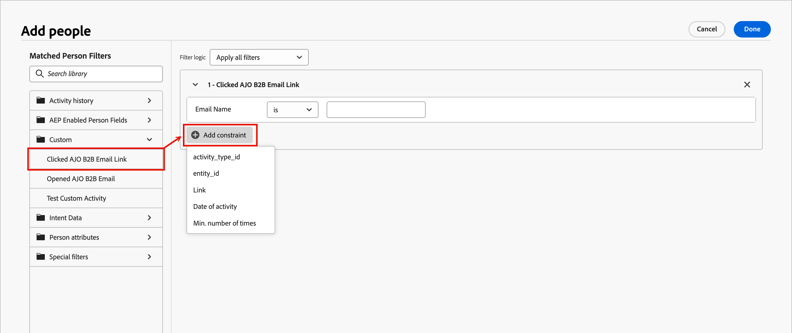

# Listes de personnes statiques

Une liste de [personnes statique](./people-lists.md) est une collection de profils de personnes dont l’appartenance change uniquement lorsque vous ajoutez ou supprimez des personnes. Des filtres simples qui référencent les attributs et les activités d’une personne définissent l’appartenance à une liste statique. L’appartenance ne change que lorsque vous ajoutez ou supprimez des membres. Vous pouvez effectuer les actions suivantes :

* [Ajoutez des personnes](#static-list-add-members) en appliquant un jeu de filtres évalué une seule fois, lorsque vous l’appliquez.
* Ajoutez et supprimez des personnes par le biais d’un compte ou d’un parcours de personnes à l’aide des actions [!UICONTROL Ajouter à la liste des personnes] et [!UICONTROL Supprimer de la liste des personnes]. (Voir [Utiliser des listes de personnes dans les parcours](./people-lists-journeys.md))
<!-- * [Activate the list to a destination](#static-list-activate) to sync its membership downstream. -->

>[!NOTE]
>
>Les définitions de filtre de liste statique s’appliquent une seule fois, lorsque vous ajoutez des membres à la liste. Le filtre défini n’est pas disponible par la suite. Si vous souhaitez conserver une définition d’audience cohérente à l’aide de filtres, utilisez plutôt une [liste dynamique](./people-lists-dynamic.md).

## Ajouter des membres {#static-list-add-members}

>[!NOTE]
>
>Si vous souhaitez qu’une liste statique démarre vide, n’appliquez pas de filtres. Une liste statique vide est utile lorsque vous prévoyez d’ajouter des membres par le biais de parcours.

1. Ouvrez la liste statique et cliquez sur **[!UICONTROL Ajouter des personnes]** en haut à droite.

   {width="700" zoomable="yes"}

1. Dans la boîte de dialogue _[!UICONTROL Ajouter des personnes]_, définissez les règles de qualification des profils en faisant glisser des filtres depuis le panneau de gauche.

   Filtrer les profils à l’aide de n’importe quelle combinaison des éléments suivants :

   * Historique des activités
   * Champs de personne activés pour Experience Platform
   * Champs personnalisés
   * Données d’intention
   * Attributs de la personne
   * Filtres spéciaux, tels que l’appartenance à un parcours

   Les filtres sont imbriqués dans des dossiers de catégories. Développez chaque dossier et faites défiler les filtres disponibles, ou utilisez le champ _Rechercher_ en haut pour localiser le filtre dont vous avez besoin. Pour chaque filtre que vous ajoutez :

   * Faites glisser le filtre du panneau de gauche vers l’espace de définition du filtre.
   * Complétez la définition de l’évaluation de correspondance.
   * Cliquez sur **[!UICONTROL Ajouter des contraintes]** pour affiner les critères correspondants.

   Ajustez vos conditions en appliquant la **[!UICONTROL logique de filtre]** en haut. Vous pouvez choisir de correspondre à toutes les conditions, à n’importe quelle condition ou de définir une logique avancée.

   {width="800" zoomable="yes"}

1. Cliquez sur **[!UICONTROL Terminé]** pour enregistrer vos modifications.

   Le système traite la demande et affiche un message de confirmation lorsque des personnes sont ajoutées. Le temps de traitement dépend du nombre de personnes à évaluer et des critères de filtre que vous avez sélectionnés. À mesure que la liste se remplit, utilisez **[!UICONTROL Actualiser les membres]** dans le menu _[!UICONTROL Plus]_ pour actualiser la liste.

   Les membres qualifiés apparaissent dans la liste après un bref délai. Le jeu de filtres est évalué une fois, de sorte que les personnes qui correspondent ultérieurement aux filtres ne sont pas automatiquement ajoutées. Vous pouvez répéter ce processus à tout moment pour ajouter d’autres personnes à la liste.

   {width="700" zoomable="yes"}

## Supprimer des membres {#static-list-remove-members}

Vous pouvez supprimer automatiquement des personnes d&#39;une liste statique via un parcours à l&#39;aide de l&#39;action [!UICONTROL Supprimer de la liste des personnes]. (Voir [Utiliser des listes de personnes dans les parcours](./people-lists-journeys.md))

<!--
TODO: Restore this section when the activate to a destination function is released.

## Activate to a destination {#static-list-activate}

Activating a static people list sends its membership to a connected destination, with ongoing sync instead of a one-time export. This is useful for paid media targeting, suppression, and downstream orchestration.

* The static list acts as a container for the people.
* The activation sends and syncs that membership to a destination.
* People added to the list later are propagated automatically.
* People removed later are deactivated automatically.

>[!PREREQUISITES]
>
>You must have one or more configured destinations for your [!DNL Journey Optimizer B2B Edition] sandbox before you can activate a static list to a destination. See [Destinations](./destinations.md).

1. Select the **[!UICONTROL Static lists]** tab.

1. Locate the static list that you want to activate, click the _More menu_ ( **...** ) icon next to the list, and choose **[!UICONTROL Activate to destination]**.

   {width="450"}

   You can also open the static list and use the **[!UICONTROL More]** menu at the top right.

1. Select the check box for the configured destination connection.

   {width="600" zoomable="yes"}

1. Click **[!UICONTROL Save]**.

1. In the _[!UICONTROL Activate list to destination]_ dialog, click **[!UICONTROL Activate]** to confirm.

When activation completes, a confirmation message appears and the destination shows as **[!UICONTROL Active]** on the **[!UICONTROL Destinations]** tab of the list. You can activate a static list to more than one destination at a time. Membership syncs to all of them.

To review the destinations that a static list is activated to, open the list and select the **[!UICONTROL Destinations]** tab.

### Deactivate a destination {#deactivate-destination}

Remove a destination connection from a static list when you no longer want its membership synced downstream.

1. Open the static list and select the **[!UICONTROL Destinations]** tab.

1. Use the row action to remove the destination that you want to disconnect.

1. Confirm in the _[!UICONTROL Deactivate destination]_ dialog.

Deactivating removes the destination from the list. The people in the list are also removed from the connected destination audience.

-->
