# Partager et fusionner des chemins {#split-paths}

Utilisez les nœuds de chemin de division et de fusion pour segmenter les personnes ou les comptes en fonction des conditions que vous définissez. Créez des chemins d’accès pour l’audience ou la liste de comptes en fonction de conditions, définissez chaque chemin d’accès avec des nœuds d’action et d’événement pour le segment, puis combinez les chemins d’accès et poursuivez le parcours.

{width="30"} [Regarder la vidéo de présentation](#overview-video)

Un nœud _Chemins partagés_ définit un ou plusieurs chemins segmentés en fonction de **_filtres de compte ou de personnes_**. Une division basée sur un filtre de personnes est automatiquement fermée par un nœud de chemins de fusion afin que toutes les personnes puissent passer à l’étape suivante sans perdre le contexte de leur compte.

>[!NOTE]
>
>25 chemins au maximum sont pris en charge.

## Fractionner les chemins par comptes {#split-paths-by-accounts}

**_(parcours de compte uniquement)_**

Les chemins de division par comptes peuvent inclure des actions et des événements de compte et de personnes. Ces chemins peuvent être divisés davantage.

_&#x200B;**Fonctionnement d’un chemin de partage par nœud de comptes**&#x200B;_

* Chaque chemin d’accès que vous ajoutez comprend un nœud d’extrémité avec la possibilité d’ajouter des nœuds à chaque arête.
* Les nœuds Fractionnés par compte peuvent être imbriqués (vous pouvez fractionner le chemin d’accès par comptes à plusieurs reprises).
* L’évaluation de chaque chemin s’effectue de haut en bas. Si un compte correspond au premier et au second chemin, il continue le long du premier chemin uniquement.
* Plusieurs chemins peuvent être combinés à l’aide d’un nœud de fusion.
* Le nœud prend en charge la définition d’un chemin d’accès _[!UICONTROL Autres comptes]_, où vous pouvez ajouter des actions ou des événements pour les comptes qui ne correspondent pas à l’un des segments/chemins définis.

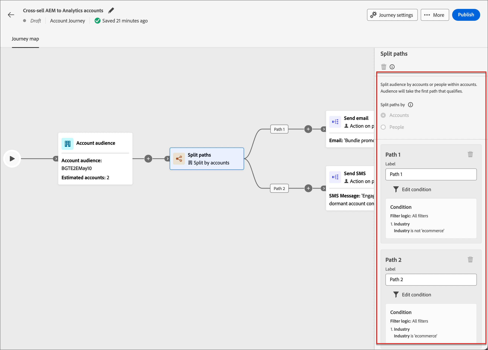{width="700" zoomable="yes"}

### Conditions de chemin du compte {#account-path-filters}

| Conditions de chemin | Description |
| --------------- | ----------- |
| [!UICONTROL Attributs De Compte] | Attributs du profil de compte, notamment : <li>Revenus annuels <li>Ville <li>Pays <li>Taille de la personne employée <li>Secteur industriel <li>Nom <li>Code SIC <li>État |
| [!UICONTROL Objets Personnalisés] > Contient `<custom object>` | [!BADGE Beta]{type=Informative tooltip="Fonctionnalité Beta"} Le compte ne possède pas d’enregistrements de schéma relationnel. Il peut également être évalué par rapport à l’un des critères d’objet personnalisés sélectionnés, tels que configurés dans le [schéma relationnel XDM](../admin/xdm-field-management.md#relational-schemas). (Voir [_Filtrage personnalisé des données_](#custom-data-filtering).) |
| [!UICONTROL Filtres spéciaux] > [!UICONTROL Le compte correspond au groupe d&#39;achat] | Le compte est associé à un ou plusieurs groupes d&#39;achats. Il peut être évalué par rapport à une ou plusieurs des contraintes suivantes pour un groupe d&#39;achat apparié : <li>Intérêt de la solution <li>Étape du groupe d&#39;achat <li>Statut du groupe d&#39;achat <li>Score d’engagement <li>Score d&#39;exhaustivité <li> Nombre de personnes dans le rôle de groupe d’achat |
| [!UICONTROL Filtres spéciaux] > [!UICONTROL Membre du compte de la liste des comptes] | Le compte est membre ou non d’une ou de plusieurs listes de comptes sélectionnées. (Voir [_Nœud de chemins partagés - Membre du compte de la liste des comptes_](../accounts/account-lists-journeys.md#split-paths-account-member-of-account-list)) |

### Ajouter un chemin de division par nœud de compte {#add-a-split-path-by-account-node}

1. Accédez à la carte du parcours.

1. Cliquez sur l’icône plus ( **+** ) d’un chemin d’accès et choisissez **[!UICONTROL Fractionner les chemins d’accès]**.

   {width="300" zoomable="no"}

1. Dans les propriétés de nœud sur la droite, choisissez **[!UICONTROL Comptes]** pour la division.

1. Pour définir une condition applicable à _[!UICONTROL Chemin 1]_, cliquez sur **[!UICONTROL Appliquer la condition]**.

   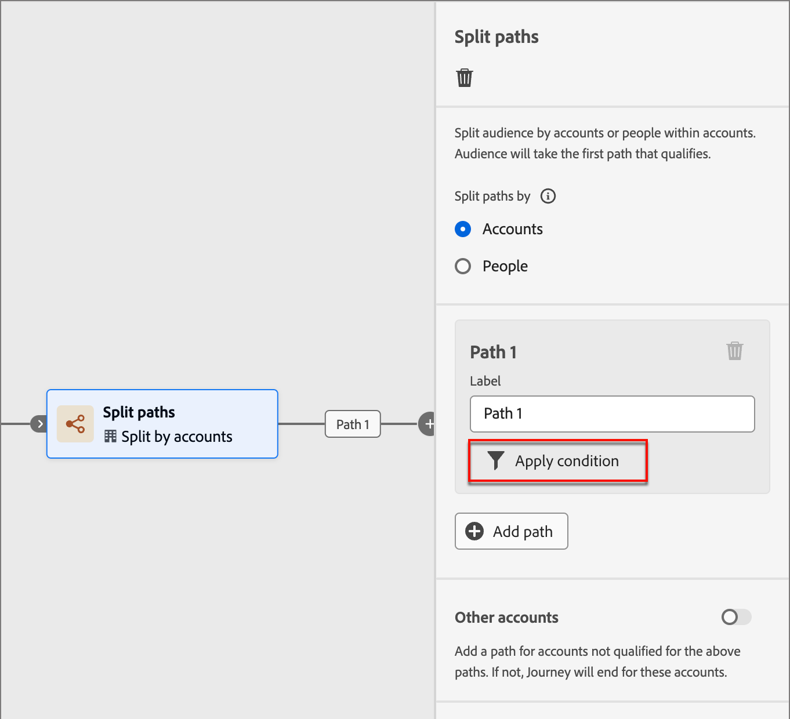{width="500" zoomable="yes"}

1. Pour définir le chemin de division, ajoutez un ou plusieurs filtres dans l’éditeur de conditions.

   * Faites glisser et déposez les attributs de filtre à partir du volet de navigation de gauche et terminez la définition de correspondance.

   * Affinez vos conditions en appliquant la **[!UICONTROL logique de filtre]** en haut. Vous choisissez de faire correspondre tous les filtres ou n’importe quel filtre.

     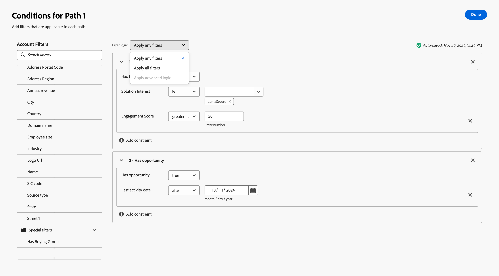{width="700" zoomable="yes"}

   * Cliquez sur **[!UICONTROL Terminé]**.

1. Pour ajouter d’autres chemins, cliquez sur **[!UICONTROL Ajouter un chemin]** et répétez les étapes précédentes pour ajouter des conditions applicables à ce chemin.

   Vous pouvez également libeller chaque chemin d’accès en fonction de ces conditions ou utiliser les libellés par défaut.

1. Si nécessaire, réorganisez les chemins en fonction de la priorité que vous souhaitez pour la division.

   Le filtrage des chemins d’accès est évalué dans l’ordre décroissant. Chaque compte suit le premier chemin qui correspond.

   Cliquez sur les flèches vers le haut et vers le bas en haut à droite de chaque carte de chemin pour la déplacer vers le haut ou le bas dans la liste des chemins.

   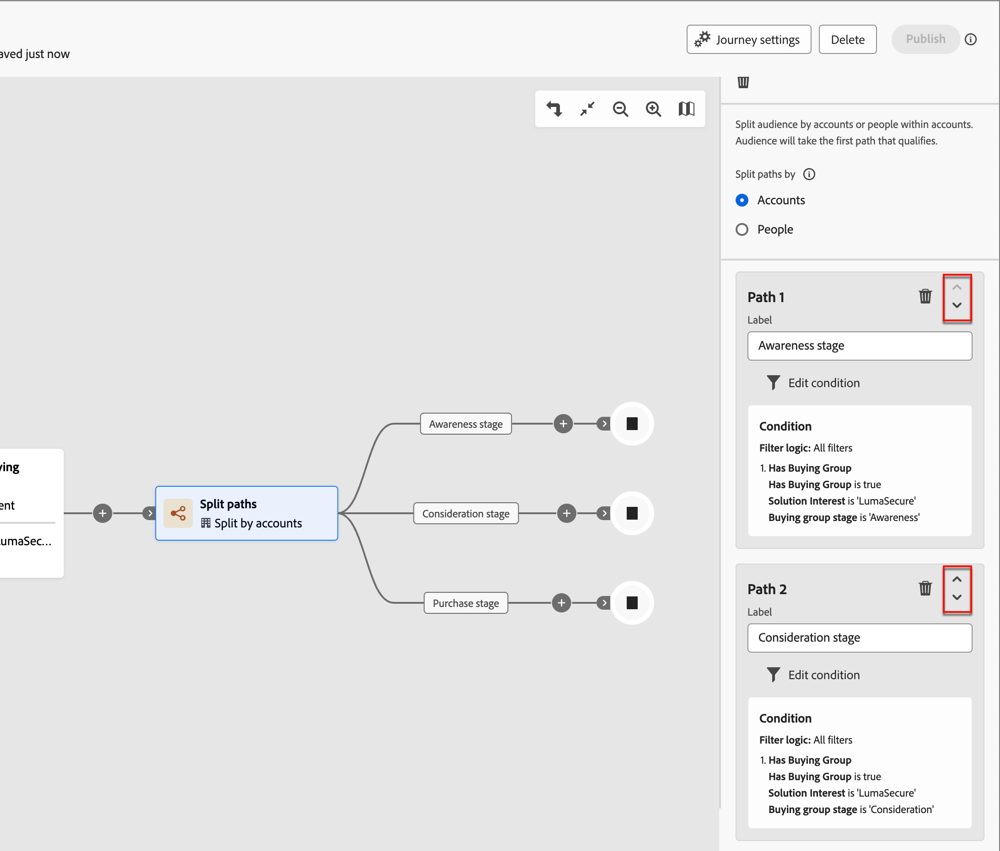{width="500" zoomable="yes"}

1. Activez l’option **[!UICONTROL Autres comptes]** pour définir le chemin d’accès par défaut pour les comptes qui ne correspondent pas aux segments/chemins d’accès définis.

   Lorsque cette option n’est pas activée, le parcours se termine pour les comptes qui ne correspondent pas à un segment/chemin d’accès défini dans la division.

### Filtrage des groupes d&#39;achats pour les comptes {#buying-group-filtering-accounts}

Vous pouvez définir un chemin pour les comptes associés aux groupes d&#39;achats et filtrer le chemin à l&#39;aide des critères de groupe d&#39;achats. Utilisez le filtre **[!UICONTROL Le compte a apparié le groupe d’achats]** pour définir le segment de chemin à l’aide d’un groupe d’achats apparié. Ce filtre inclut également la possibilité d&#39;identifier les comptes en fonction du nombre de rôles attribués au sein d&#39;un groupe d&#39;achat apparié.

Par exemple, évaluez la préparation du groupe d&#39;achat en fonction de la profondeur (nombre de personnes) qu&#39;il a dans différents rôles, tels que trois décideurs et deux influenceurs. Dans ce cas, définissez la condition pour cibler les comptes avec un minimum de trois (3) Décideurs et deux (2) Influenceurs dans un groupe d&#39;achat apparié :

1. Cliquez sur **[!UICONTROL Ajouter un filtre]** et choisissez le filtre **[!UICONTROL Nombre de personnes dans le rôle de groupe d&#39;achat]**.

   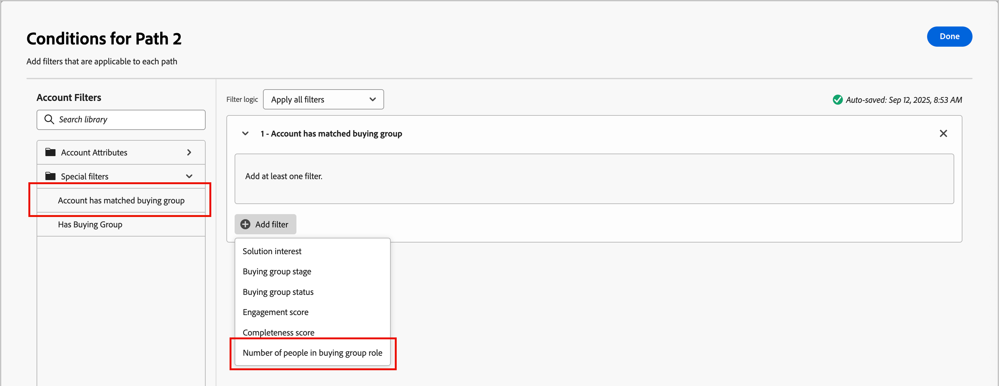{width="700" zoomable="yes"}

1. Définissez le premier paramètre de rôle.

   * Définissez l’évaluation du nombre de personnes sur `at least` avec une valeur de `3`.
   * Définissez l’évaluation du rôle sur `is` et choisissez `Decision Maker` dans la liste des rôles.

1. Répétez l&#39;étape 1 pour ajouter un autre paramètre de rôle de groupe d&#39;achat.

1. Définissez le deuxième paramètre de rôle.

   * Définissez l’évaluation du nombre de personnes sur `at least` avec une valeur de `2`.
   * Définissez l’évaluation du rôle sur `is` et choisissez `Influencer` dans la liste des rôles.

   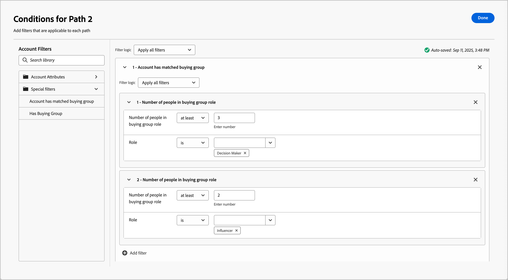{width="700" zoomable="yes"}

1. Cliquez sur **[!UICONTROL Terminé]** lorsque toutes les conditions du chemin d’accès sont définies.

Pour mettre à jour le statut du groupe d&#39;achats ou de l&#39;étape pour les comptes identifiés, ajoutez un nœud action dans le chemin d&#39;accès.

### Filtrage de la liste des comptes {#account-list-filtering}

Utilisez le filtre _[!UICONTROL Filtres spéciaux]_ > _[!UICONTROL Membre du compte de la liste des comptes]_ pour définir un chemin d’accès pour les comptes en fonction de leur appartenance à une [liste des comptes](../accounts/account-lists.md). Définissez l’appartenance sur _true_ pour inclure des comptes dans les listes ou _false_ pour les exclure, puis sélectionnez une ou plusieurs listes de comptes. Par exemple, pour exclure des comptes d&#39;un chemin d&#39;accès, ajoutez le filtre, définissez l&#39;appartenance sur _false_ et sélectionnez votre place sur la liste bloquée.

Pour connaître les étapes, voir [Nœud de chemins partagés - Membre du compte de la liste des comptes](../accounts/account-lists-journeys.md#split-paths-account-member-of-account-list).

## Fractionner les chemins par personnes

_(parcours de compte et de personne)_

Les chemins fractionnés par personnes ne peuvent inclure que des actions de personnes. Ces chemins ne peuvent pas être fractionnés à nouveau et rejoints automatiquement.

_&#x200B;**Fonctionnement d’un chemin de partage par nœud de personnes**&#x200B;_

* Les nœuds fractionnés par personnes fonctionnent dans une combinaison de division/fusion _nœud groupé_. Les chemins de division fusionnent automatiquement afin que toutes les personnes puissent passer à l’étape suivante sans perdre le contexte de leur compte.
* Les nœuds Fractionné par personnes ne peuvent pas être imbriqués (vous ne pouvez pas ajouter de chemin de fractionnement pour les personnes sur un chemin qui se trouve dans ce nœud groupé).
* L’évaluation de chaque chemin s’effectue de haut en bas. Si une personne correspond au premier et au second chemin, elle continue uniquement le long du premier chemin.
* Le nœud prend en charge l’utilisation des _relations compte-personne_, qui vous permettent de filtrer les personnes en fonction de leur rôle (comme entrepreneur ou employé à temps plein), tel que défini dans la relation.
* Le nœud prend en charge la définition d’un chemin d’accès _[!UICONTROL Autres personnes]_, où vous pouvez ajouter des actions ou des événements pour les personnes qui ne correspondent pas à l’un des segments/chemins définis.

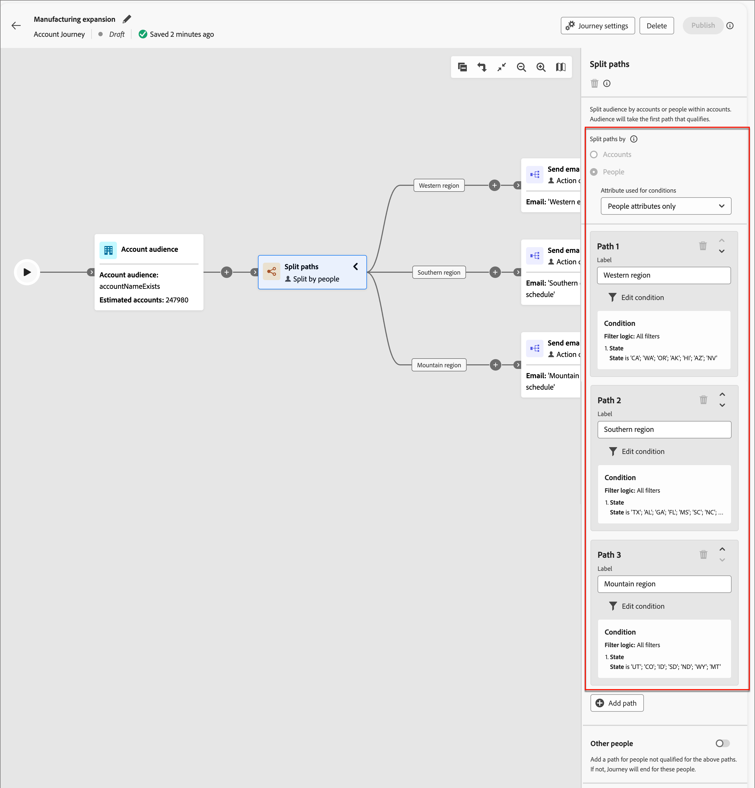{width="700" zoomable="yes"}

### Filtres de chemin d’accès des personnes {#people-path-filters}

| Filtres | Description |
| ------------ | ----------- |
| [!UICONTROL Objets Personnalisés] > Contient `<custom object>` | [!BADGE Beta]{type=Informative tooltip="Fonctionnalité Beta"} La personne dispose ou non d’enregistrements de schéma relationnel. Il peut également être évalué par rapport à l’un des critères d’objet personnalisés sélectionnés, tels que configurés dans le [schéma relationnel XDM](../admin/xdm-field-management.md#relational-schemas). (Voir [Filtrage personnalisé des données](#custom-data-filtering)) |
| [!UICONTROL Historique des événements] | Divise les personnes en fonction des événements d’expérience qui se sont produits avant l’entrée sur le parcours. Développez le dossier pour afficher tous les types d’événements configurés dans [Admin > Configuration d’événement XDM](../admin/configure-aep-events.md) et sélectionnez-en un à ajouter en tant que filtre. Les contraintes comprennent les champs de l’événement sélectionné, un intervalle de temps de recherche en amont mesuré à partir du moment où la personne accède au parcours et un nombre minimum de fois facultatif. |
| [!UICONTROL Attributs de personne] | Attributs du profil de [personne](../admin/field-mapping.md#xdm-business-person-attributes), notamment : <li>Ville <li>Pays <li>Adresse e-mail <li>E-mail non valide <li>E-mail interrompu <li>Prénom <li>Région déduite <li>Titre du traitement <li>Nom <li>Numéro téléphone mobile <li>Score d’engagement des personnes <li>Numéro de téléphone <li>Code postal <li>État |
| [!UICONTROL Filtres spéciaux] > [!UICONTROL Membre du groupe d&#39;achat] | La personne est ou n&#39;est pas un membre du groupe d&#39;achats évalué par rapport à un ou plusieurs des critères suivants : <li>Intérêt de la solution</li><li>Statut du groupe d&#39;achat</li><li>Score d&#39;exhaustivité</li><li>Score d’engagement</li><li>Est supprimé (valeur par défaut : `false`)</li><li>Rôle</li> (Voir [_Filtrage des appartenances_](#membership-filtering)) |
| [!UICONTROL Filtres spéciaux] > [!UICONTROL Membre de l’audience du profil] | La personne est membre ou non d&#39;une ou de plusieurs audiences de profil [!DNL Adobe Experience Platform]. (Voir [_Filtrage des appartenances_](#membership-filtering)) |
| [!UICONTROL Filtres spéciaux] > [!UICONTROL Membre de la liste dynamique de compte] | (parcours de personne uniquement) Le compte de la personne est membre ou non d’une ou de plusieurs listes de comptes dynamiques. (Voir [_Membre de la personne de la liste des comptes_](../accounts/account-lists-journeys.md#split-paths-member-of-account-list)) |
| [!UICONTROL Filtres spéciaux] > [!UICONTROL Membre de la liste statique du compte] | (parcours de personne uniquement) Le compte de la personne est membre ou non d’une ou de plusieurs listes de comptes statiques. (Voir [_Membre de la personne de la liste des comptes_](../accounts/account-lists-journeys.md#split-paths-member-of-account-list)) |
| [!UICONTROL Filtres spéciaux] > [!UICONTROL Membre de la liste dynamique des personnes] | La personne est membre ou non d’une ou de plusieurs listes de personnes dynamiques. (Voir [_Filtrage des appartenances_](#membership-filtering)) |
| [!UICONTROL Filtres spéciaux] > [!UICONTROL Membre de la liste statique des personnes] | La personne est membre ou non d’une ou de plusieurs listes de personnes statiques. (Voir [_Filtrage des appartenances_](#membership-filtering)) |

### Conditions de chemin compte-personne

| Conditions de chemin | Description |
| --------------- | ----------- |
| [!UICONTROL Rôle dans le compte] | Un rôle dans le compte est attribué ou non à la personne. Contraintes facultatives : <li>Nom du rôle |

### Ajouter un nœud de partage de chemin par personnes {#add-a-split-path-by-people-node}

>[!NOTE]
>
>Lorsque vous fractionnez des chemins d’accès par personnes, un nœud _Fermer le fractionnement des chemins d’accès_ est automatiquement inséré pour mettre fin au fractionnement. Un chemin d’accès fractionné par personnes permet uniquement _d’effectuer une action_ sur les nœuds de personnes.

1. Accédez à la carte du parcours.

1. Cliquez sur l’icône plus ( **+** ) d’un chemin d’accès et choisissez **[!UICONTROL Fractionner les chemins d’accès]**.

   {width="300" zoomable="no"}

1. Dans les propriétés de nœud sur la droite, choisissez **[!UICONTROL Personnes]** pour la division.

1. (parcours de compte uniquement) Définissez les **[!UICONTROL attributs utilisés pour les conditions]**.

   * Choisissez **[!UICONTROL Attributs de personne uniquement]** pour utiliser des conditions liées au profil de personne.
   * Choisissez **[!UICONTROL Attributs de compte-personne uniquement]** pour utiliser les conditions liées à l’appartenance au rôle de la personne dans un compte.

1. Pour définir une condition applicable à _[!UICONTROL Chemin 1]_, cliquez sur **[!UICONTROL Appliquer la condition]**.

1. Pour définir le chemin de division, ajoutez un ou plusieurs filtres dans l’éditeur de conditions.

   * Faites glisser et déposez l’un des filtres de personnes à partir du volet de navigation de gauche et terminez la définition de la correspondance.

     >[!NOTE]
     >
     >Si des champs de personne personnalisés sont définis dans le schéma d’audience de comptes dans Experience Platform, ces champs peuvent également être utilisés comme attributs de personne dans les conditions.

   * Affinez vos conditions en appliquant la **[!UICONTROL logique de filtre]** en haut. Vous choisissez de faire correspondre toutes les conditions d’attribut ou n’importe quelle condition.

     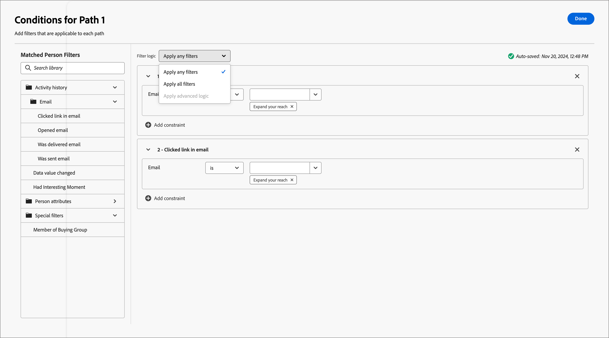{width="700" zoomable="yes"}

   * Cliquez sur **[!UICONTROL Terminé]**.

1. Pour ajouter d’autres chemins, cliquez sur **[!UICONTROL Ajouter un chemin]** et répétez les étapes précédentes pour ajouter des conditions applicables à ce chemin.

   Vous pouvez également libeller chaque chemin d’accès en fonction de ces conditions ou utiliser les libellés par défaut.

1. Si nécessaire, réorganisez les chemins en fonction de la priorité que vous souhaitez pour la division.

   Le filtrage des chemins d’accès est évalué dans l’ordre décroissant. Chaque personne suit le premier chemin correspondant.

   Cliquez sur les flèches vers le haut et vers le bas en haut à droite de chaque carte de chemin pour la déplacer vers le haut ou le bas dans la liste des chemins.

   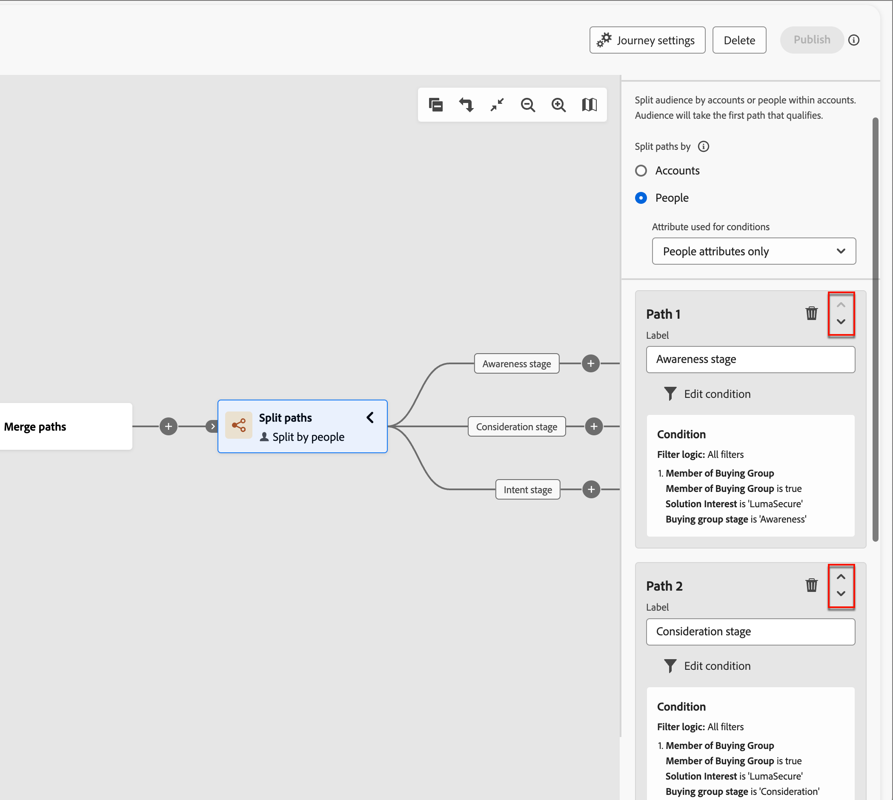{width="500" zoomable="yes"}

1. Activez l’option **[!UICONTROL Autres personnes]** pour ajouter un chemin par défaut pour les personnes qui ne correspondent pas aux chemins définis.

   Lorsque cette option n’est pas activée, les personnes qui ne correspondent pas à un segment/chemin défini passent au-delà de la division et passent à l’étape suivante du parcours.

   Lorsque des conditions sont définies pour chaque chemin d’accès afin de fractionner votre audience au niveau des personnes, vous pouvez ajouter des actions que vous souhaitez entreprendre sur les personnes.

### Filtrage de l’historique des événements d’expérience {#experience-event-history-filtering}

Pour un chemin de partage par personnes, vous pouvez définir un chemin en fonction des événements d’expérience qui se sont produits avant que la personne ne rejoigne le parcours. Pour afficher la liste de tous les types d’événements configurés par votre administrateur, développez le dossier **[!UICONTROL Historique des événements]** dans l’éditeur de conditions. Sélectionnez un type d’événement pour l’ajouter en tant que condition de filtre.

La fenêtre temporelle de l’historique des événements est mesurée à rebours à partir du moment où la personne entre dans le parcours. Par exemple, une fenêtre de 30 jours évalue si l’événement éligible s’est produit au cours des 30 jours précédant l’entrée sur le parcours.

Vous pouvez affiner davantage le filtre à l&#39;aide de contraintes spécifiques aux champs de l&#39;événement sélectionné. Les contraintes facultatives **[!UICONTROL Nombre minimum de fois]** et **[!UICONTROL Date de l’activité]** sont toutes deux évaluées dans l’intervalle de recherche en amont défini. Comme les données de l&#39;historique des événements sont synchronisées à partir de [!DNL Adobe Experience Platform], un bref délai peut s&#39;écouler avant qu&#39;un événement récent ne soit disponible pour ce filtre.

>[!NOTE]
>
>Les [configurations des événements d’expérience et des champs](../admin/configure-aep-events.md) déterminent les événements disponibles dans le dossier [!UICONTROL Historique des événements].

**Exemple :** Pour acheminer les personnes qui ont cliqué sur un lien dans un e-mail marketing avant d’entrer dans le parcours, sélectionnez l’événement de clic sur l’e-mail dans le dossier [!UICONTROL Historique des événements], définissez l’intervalle de recherche en amont et appliquez des contraintes au niveau du champ, si nécessaire.

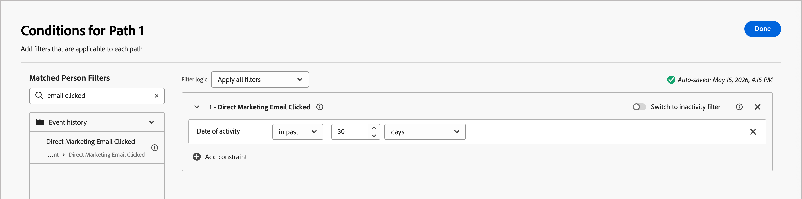{width="700" zoomable="yes"}

>[!BEGINSHADEBOX « Filtrage d’inactivité »]

Pour chacun des filtres _[!UICONTROL Historique des événements]_, vous pouvez activer l’option **[!UICONTROL Passer au filtre d’inactivité]**. Cette option transforme le filtre en évaluation d’une absence de ce type d’activité. Pour créer un chemin d’accès pour les personnes qui _&#x200B;**n’ont pas ouvert d’e-mail**&#x200B;_, ajoutez le filtre _[!UICONTROL E-mail de marketing direct ouvert]_. Activez l’option d’inactivité et indiquez l’adresse e-mail.

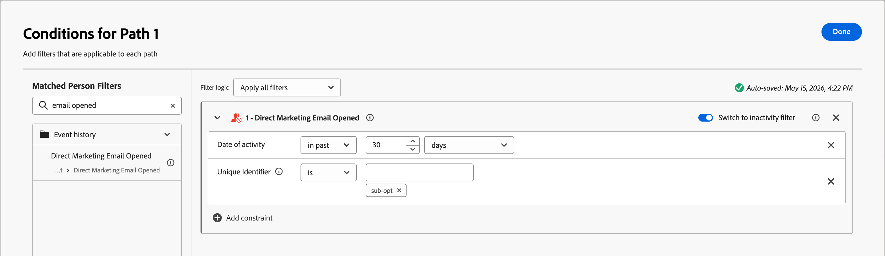{width="700" zoomable="yes"}

>[!ENDSHADEBOX]

### Filtrage des appartenances {#membership-filtering}

Dans la section _[!UICONTROL Filtres spéciaux]_, utilisez les filtres suivants pour créer des chemins d’accès en fonction de l’appartenance d’une personne :

* _[!UICONTROL Membre du groupe d&#39;achat]_ - Évalue si la personne est membre d&#39;un groupe d&#39;achat.
* _[!UICONTROL Membre de l’audience de profil]_ - Évalue si la personne est membre d’une audience de profil [!DNL Adobe Experience Platform].
* _[!UICONTROL Liste dynamique des membres de comptes de personnes]_ - (parcours de personnes uniquement) Évalue si le compte de la personne est membre d’une liste de comptes dynamique. (Voir [Utiliser des listes de comptes dans parcours](../accounts/account-lists-journeys.md#split-paths-member-of-account-list))
* _[!UICONTROL Liste statique des membres des personnes de compte]_ - (parcours de personne uniquement) Évalue si le compte de la personne est membre d’une liste de comptes statique. (Voir [Utiliser des listes de comptes dans parcours](../accounts/account-lists-journeys.md#split-paths-member-of-account-list))
* _[!UICONTROL Membre de la liste dynamique des personnes]_ - Évalue si la personne est membre d&#39;une liste dynamique des personnes.
* _[!UICONTROL Membre de la liste statique des personnes]_ - Évalue si la personne est membre d&#39;une liste statique des personnes.

Pour ajouter un filtre d’appartenance, faites-le glisser du dossier _[!UICONTROL Filtres spéciaux]_ vers l’espace de travail des conditions et remplissez la définition de correspondance pour inclure ou exclure des membres. Selon le filtre, vous sélectionnez _true_ ou _false_, ou choisissez _is_ ou _is not_. Vous pouvez combiner ces filtres dans la même condition de chemin d’accès et utiliser la **[!UICONTROL logique de filtre]** pour les faire correspondre à l’un ou à l’ensemble des filtres.

Les filtres _[!UICONTROL Membre du groupe d’achat]_ et _[!UICONTROL Membre de l’audience du profil]_ sont également disponibles lorsque vous [ajoutez des filtres pour un événement](./listen-for-event-nodes.md#membership-filtering) dans un nœud _Écouter un événement_.

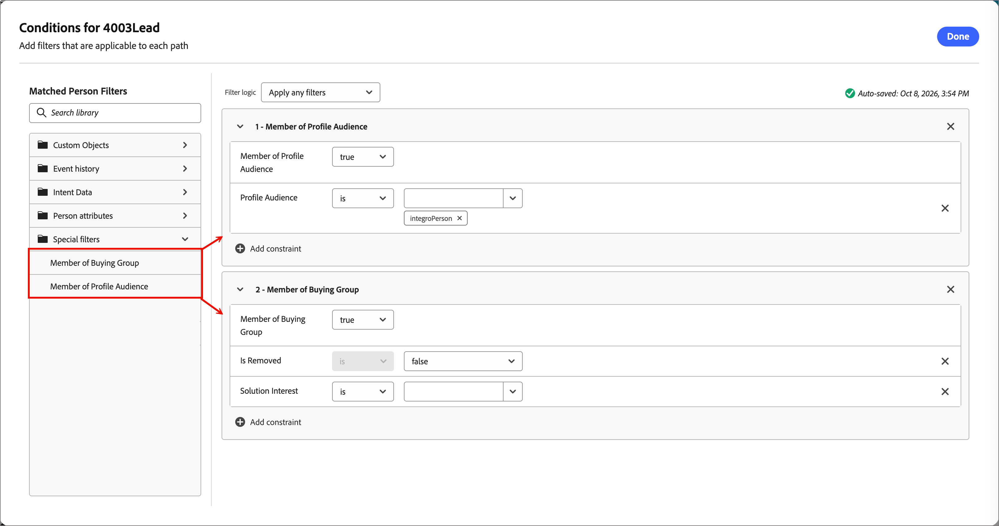{width="700" zoomable="yes"}

**Membre du groupe d&#39;achat**

Par exemple, pour créer un chemin d’accès pour les membres d’un groupe d’achat ayant un rôle spécifique, définissez l’appartenance sur _true_ et sélectionnez une _[!UICONTROL recherche de solution]_ associée aux groupes d’achat.

Lorsque vous ajoutez le filtre, le système inclut par défaut la contrainte _[!UICONTROL Est supprimé]_ et la définit sur `false`. Par conséquent, le chemin d&#39;accès inclut uniquement les membres actuels du groupe d&#39;achats.

Cliquez sur **[!UICONTROL Ajouter une contrainte]** pour inclure d&#39;autres contraintes d&#39;appartenance à un groupe d&#39;achat :

* _[!UICONTROL Étape du groupe d&#39;achat]_
* _[!UICONTROL Statut du groupe d&#39;achat]_
* _[!UICONTROL Score d&#39;exhaustivité]_
* _[!UICONTROL Score d’engagement]_
* _[!UICONTROL Rôle]_

>[!IMPORTANT]
>
>La contrainte _[!UICONTROL Est supprimé]_ détermine si les membres du groupe d&#39;achats supprimés sont évalués :
>
>* `false` (par défaut) - Renvoie uniquement les membres actuels du groupe d’achats. Les membres supprimés ne sont pas inclus.
>* `true` - Renvoie uniquement les membres du groupe d’achats supprimés. Les membres actuels ne sont pas inclus.
>* Contrainte supprimée - Renvoie les membres actuels et supprimés du groupe d&#39;achats.
>
>Si vous supprimez la contrainte, le chemin d&#39;accès peut inclure des personnes qui ne font plus partie du groupe d&#39;achat.

**Membre de l’audience du profil**

Utilisez la contrainte _[!UICONTROL Audience du profil]_ pour sélectionner une ou plusieurs audiences. Par exemple, si vous sélectionnez l’audience `integroPerson`, le chemin d’accès qualifie toutes les personnes qui étaient membres de cette audience au moment de la dernière ingestion par lots.

>[!NOTE]
>
>Le filtre ne calcule pas l’appartenance à une audience en temps réel. Il qualifie les personnes en fonction de leur appartenance à l’audience sélectionnée à partir de la dernière ingestion d’audience par lots. Seules les audiences qui ont été ingérées dans [!DNL Journey Optimizer B2B Edition] peuvent être évaluées.

**Listes de membres de comptes**

_(parcours de personne uniquement)_

Utilisez les filtres _[!UICONTROL Liste statique des membres de comptes]_ et _[!UICONTROL Liste dynamique des membres de comptes]_ pour acheminer les personnes en fonction du fait que leur compte est membre d&#39;une [liste de comptes](../accounts/account-lists.md). Définissez l’opérateur sur _is_ pour inclure les personnes dont le compte figure dans les listes ou _ne figure pas_ pour les exclure, puis sélectionnez une ou plusieurs listes de comptes. Par exemple, pour empêcher les personnes qui se trouvent dans des comptes placés sur la liste bloquée d’accéder à un chemin d’accès, ajoutez le filtre _[!UICONTROL Liste statique des membres de compte]_ de personne, définissez l’opérateur sur _n’est pas_ et sélectionnez votre.

Pour connaître les étapes, voir [Nœud de chemins partagés - Membre de la personne dans la liste des comptes](../accounts/account-lists-journeys.md#split-paths-member-of-account-list).

**Membre des listes de personnes**

Utilisez les filtres _[!UICONTROL Membre de la liste statique des personnes]_ et _[!UICONTROL Membre de la liste dynamique des personnes]_ pour acheminer les personnes en fonction de leur appartenance à une [liste des personnes](../audiences/people-lists.md). Définissez l’opérateur sur _est_ pour inclure les membres de la liste ou _n’est pas_ pour les exclure, puis sélectionnez une ou plusieurs listes. Par exemple, pour empêcher les employés et les partenaires de suivre un parcours d’éducation, ajoutez le filtre _[!UICONTROL Liste statique des membres de la personne]_, définissez l’opérateur sur _n’est pas_ et sélectionnez votre liste d’exclusion.

Pour connaître les étapes, voir [Partage de chemins par appartenance à une liste de personnes](../audiences/people-lists-journeys.md#split-paths-by-list-membership).

## Filtrage des données personnalisées {#custom-data-filtering}

[!BADGE Beta]{type=Informative tooltip="Fonctionnalité Beta"}

Vous pouvez utiliser des schémas relationnels (classes basées sur des modèles) pour fractionner les chemins d’accès par compte ou personne. Les objets personnalisés sont définis dans _les schémas relationnels_ et un administrateur de produit peut [configurer les champs de schéma relationnel](../admin/xdm-field-management.md#relational-schemas) dans [!DNL Journey Optimizer B2B Edition]. Les champs de schéma sélectionnés sont disponibles dans l’éditeur de conditions pour une utilisation dans les nœuds _partager le chemin par compte_ et _partager le chemin par personnes_.

Pour une condition **[!UICONTROL Fractionner le chemin par compte]** ou **[!UICONTROL Fractionner le chemin par personnes]**, développez _[!UICONTROL Objets personnalisés]_. Ajoutez la condition et définissez la valeur sur `true` ou `false`. Cliquez sur **[!UICONTROL Ajouter une contrainte]** pour utiliser les valeurs de champ pour le filtrage.

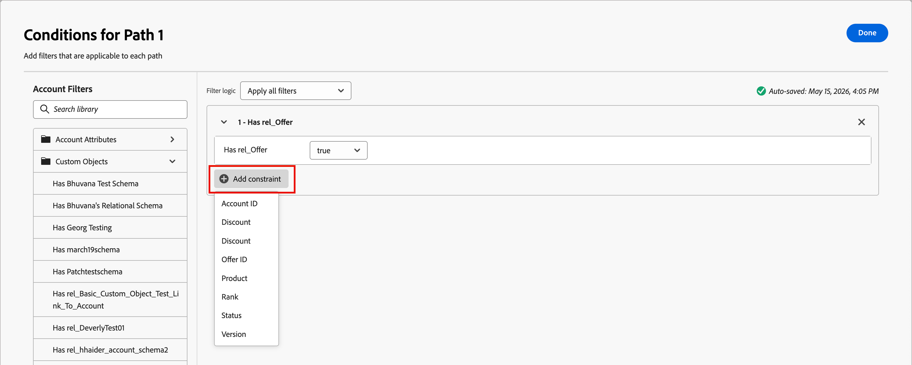{width="600" zoomable="yes"}

## Fusionner les chemins {#merge-paths}

Pour combiner différents _chemins partagés par compte_ dans votre parcours, ajoutez un nœud _Fusionner les chemins_.

1. Dans un mappage de parcours avec un nœud partagé qui comporte trois chemins ou plus, ajoutez une combinaison d’actions et d’événements à chaque chemin.

1. Cliquez sur l’icône plus ( **+** ) pour l’un de ces chemins et choisissez **[!UICONTROL Fusionner]** dans les options affichées.

   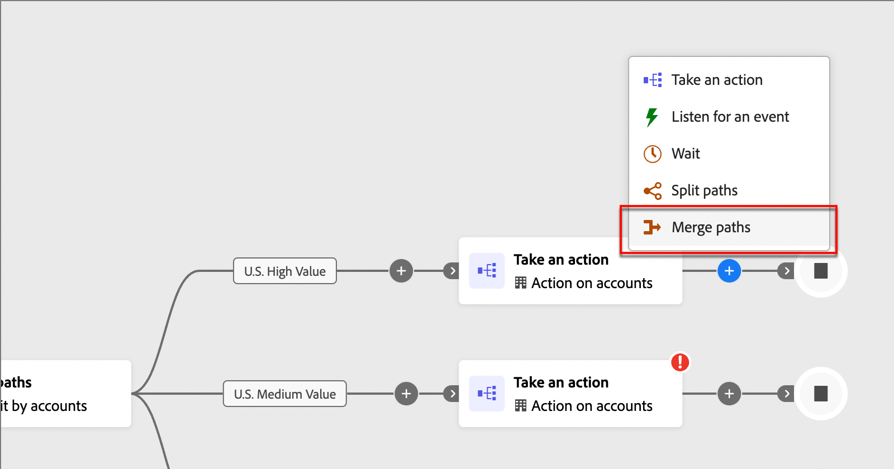{width="400" zoomable="no"}

1. Dans les propriétés du nœud de chemins de fusion, sélectionnez les chemins à fusionner.

   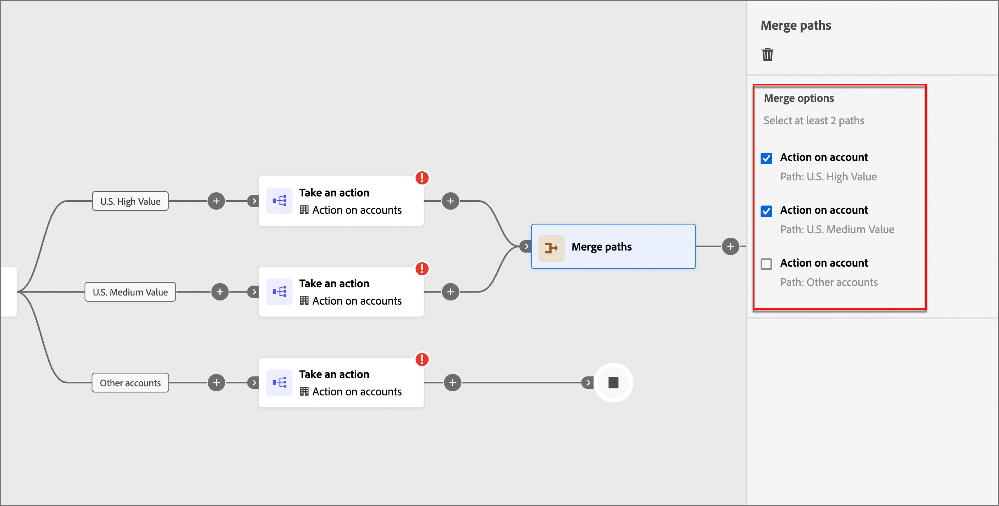{width="600" zoomable="yes"}

   Les chemins d’accès sont fusionnés afin que les comptes des chemins d’accès sélectionnés se combinent pour former un chemin d’accès unique qui peut continuer à progresser dans le parcours.

1. Si nécessaire, vous pouvez annuler la fusion des chemins en revenant aux propriétés du nœud de chemins de fusion et en décochant la case correspondant aux chemins que vous souhaitez supprimer.

## Vidéo de présentation {#overview-video}

>[!VIDEO](https://video.tv.adobe.com/v/3443231/?learn=on)
